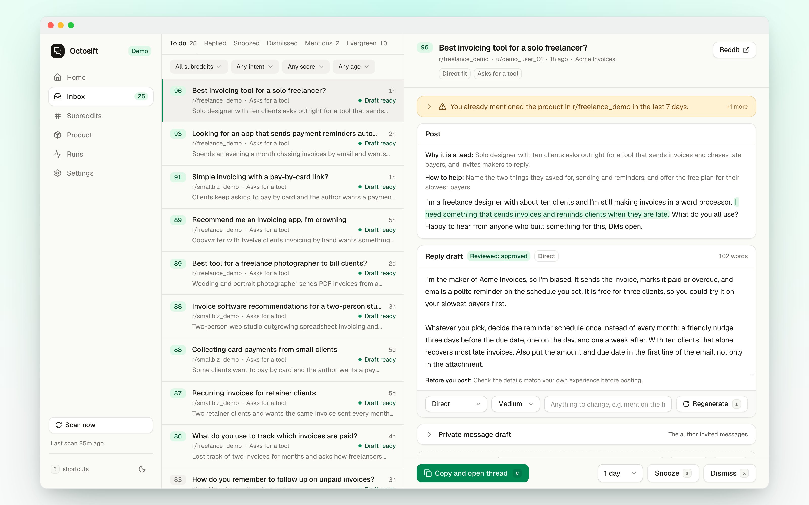
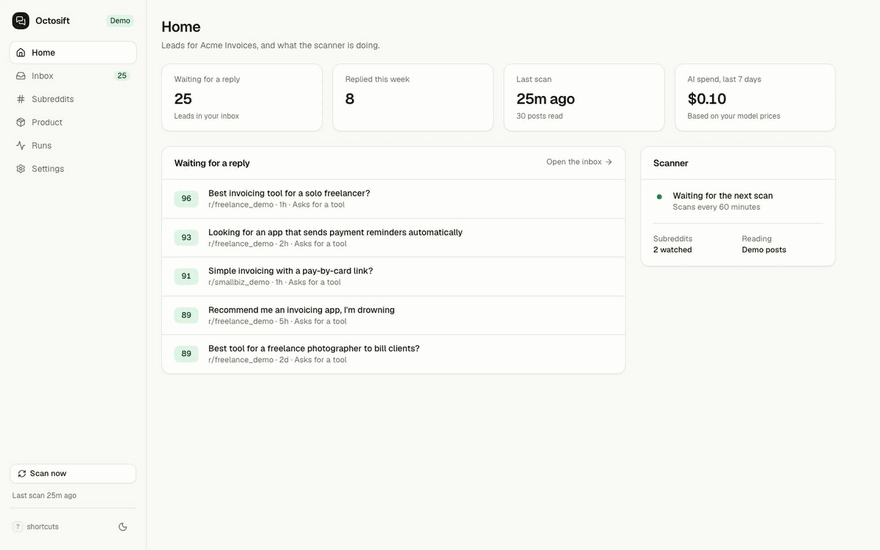
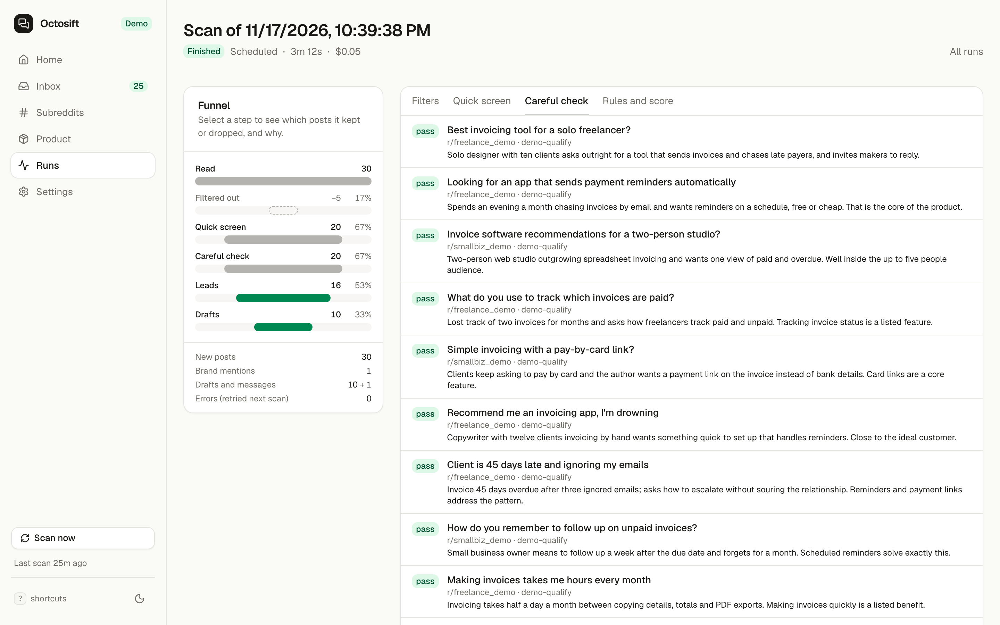
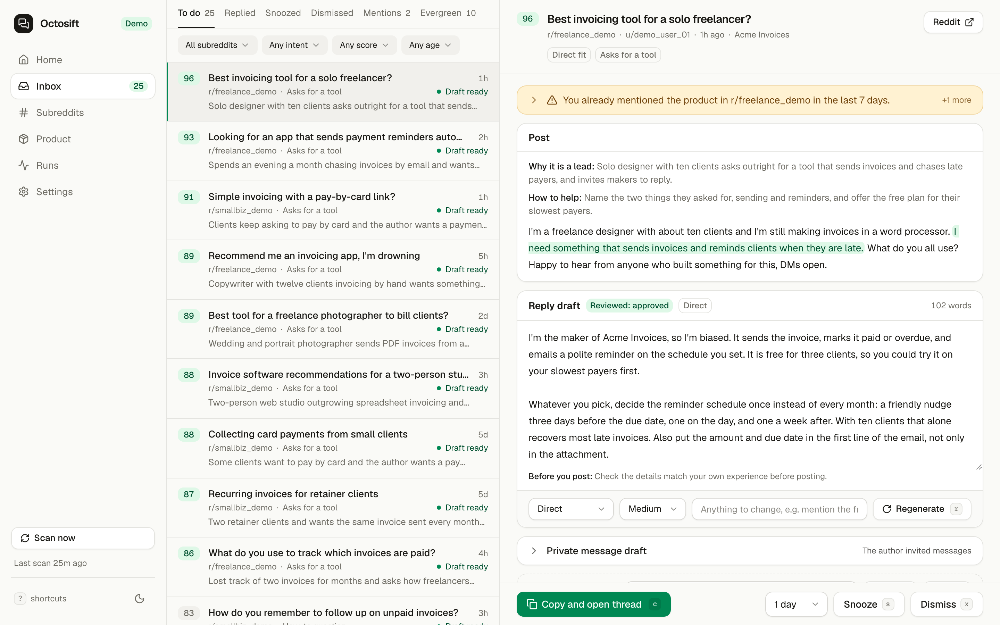
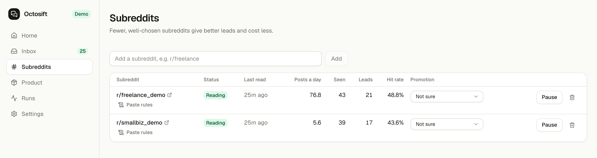
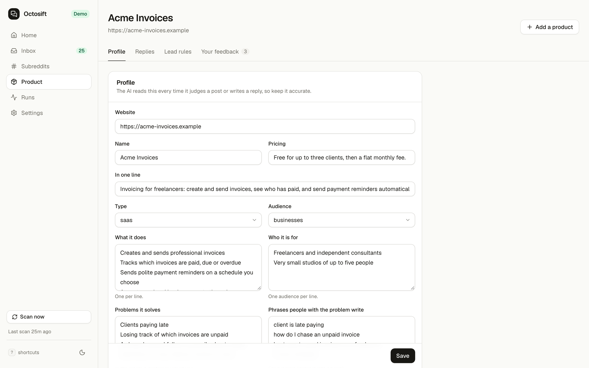
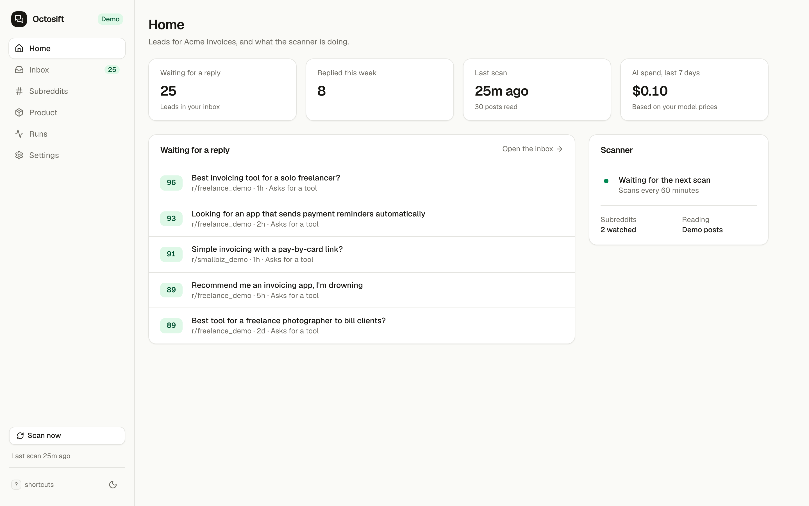
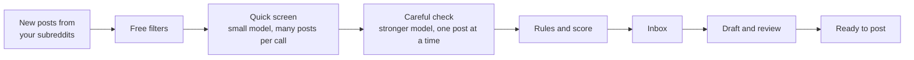

<div align="center">


# Octosift

### Find the people on Reddit who need what you built, and reply with something useful.

Octosift watches the subreddits you choose, explains which posts are real leads, and drafts
honest, reviewed replies in your voice, ready to post.
**Open source, self-hosted, bring your own AI key.**

<p>
  <a href="https://github.com/Octosift/octosift/actions/workflows/ci.yml"></a>
  <a href="LICENSE"></a>
  
  
  
  <a href="CONTRIBUTING.md"></a>
</p>

<p>
  <a href="#quick-start"><strong>Quick start</strong></a> ·
  <a href="#features"><strong>Features</strong></a> ·
  <a href="#how-it-works"><strong>How it works</strong></a> ·
  <a href="#what-it-costs"><strong>Cost</strong></a> ·
  <a href="#responsible-use"><strong>Responsible use</strong></a> ·
  <a href="docs/architecture.md"><strong>Docs</strong></a> ·
  <a href="#community"><strong>Community</strong></a>
</p>

<p>
  <a href="https://t.me/+EoZ4XW1xmy05MTQx"></a>
</p>

</div>

<br />

<picture>
  <source media="(prefers-color-scheme: dark)" srcset="docs/images/hero-dark.png" />
  
</picture>

<div align="center">

**Try it in under a minute.** The demo needs no key, no account and no network.

</div>

```sh
git clone https://github.com/Octosift/octosift.git && cd octosift
pnpm install
pnpm demo        # then open http://127.0.0.1:3005
```

## Why Octosift

The people who need your product rarely search for it. They ask a community: _"What do you
all use for this?"_ Those posts are the best leads you will ever get, and they are buried in
thousands of others. Keyword alerts flood you with noise, and replies that read like ads get
removed, downvoted or banned.

Octosift does the reading for you. It picks out the posts where you can genuinely help, tells
you why, and prepares a reply that is useful even without the sentence about your product.
Then you decide what to post.

|                                            | Reading by hand | Keyword alerts | **Octosift** |
| ------------------------------------------ | :-------------: | :------------: | :----------: |
| Finds people asking, not just mentions     |       ✅        |       ❌       |      ✅      |
| Reads every new post for you               |       ❌        |       ✅       |      ✅      |
| Explains why each post is a lead           |        —        |       ❌       |      ✅      |
| Reply drafts, reviewed before you see them |       ❌        |       ❌       |      ✅      |
| Runs on your machine with your own key     |       ✅        |       —        |      ✅      |

## See it in action

<p align="center">
  
</p>

## Features

<table>
  <tr>
    <td width="42%" valign="top">
      <h3>🎯 Leads you can check</h3>
      <p>Every post gets a verdict, a score and a plain reason. Open any scan to see each post it
      read, which stage kept or dropped it, and why. Mark a lead good or bad with a short note,
      and the next scans follow it as a rule.</p>
    </td>
    <td width="58%"></td>
  </tr>
  <tr>
    <td valign="top">
      <h3>✍️ Replies in your voice, reviewed first</h3>
      <p>A second model checks each draft the way a moderator would: it answers the question,
      invents nothing, says you built the product and does not read like an ad. Pick the angle
      and length, or ask for a rewrite in plain words. When an author invites messages, a private
      message draft is ready too.</p>
    </td>
    <td></td>
  </tr>
  <tr>
    <td valign="top">
      <h3>🛡️ Guardrails against looking like a spammer</h3>
      <p>Drafts disclose that you built the product. Subreddits that ban promotion get replies
      that do not mention it. Pacing warnings tell you when to help without a mention for a while,
      and a connected account later checks that your reply is still visible.</p>
    </td>
    <td></td>
  </tr>
  <tr>
    <td valign="top">
      <h3>🧠 It learns your product from your website</h3>
      <p>Paste a URL. Octosift reads a few pages and drafts a profile: what the product does, who
      it is for, the phrases people with the problem actually write, and what it does
      <em>not</em> do. Edit anything; every judgement and draft follows it.</p>
    </td>
    <td></td>
  </tr>
  <tr>
    <td valign="top">
      <h3>💸 Your own AI key, costs you control</h3>
      <p>OpenAI, Anthropic, or any OpenAI-compatible endpoint such as Ollama, LM Studio or
      OpenRouter. Presets show an estimated monthly cost before you spend anything, and budget
      caps stop a scan cleanly.</p>
    </td>
    <td></td>
  </tr>
  <tr>
    <td valign="top">
      <h3>🔒 Private and calm</h3>
      <p>Runs on your machine with a local SQLite file. Keys and the Reddit session are encrypted.
      No telemetry, no analytics. Home shows what is waiting and what the scanner is doing, and
      everything else stays out of your way.</p>
    </td>
    <td></td>
  </tr>
</table>

**Also included:** keyboard shortcuts for the whole inbox (`j` `k` `c` `s` `x` `?`), a webhook
for Slack or Discord, a mentions tab for posts that name your product, an optional Evergreen tab
for threads that rank on Google, a command line, Docker and a dark mode.

## How it works



1. **It learns your product.** Give it your website. It reads a few pages, drafts a profile
   (what the product does, who it is for, what it does _not_ do) and asks a few questions to
   sharpen it.
2. **It suggests subreddits.** You confirm three to ten communities where your customers ask
   for help.
3. **It reads new posts on a schedule.** Every hour by default, slowly and one request at a
   time.
4. **It judges every post.** Free filters drop removed posts, bots, spam, old posts and other
   languages. A small model screens the rest. A stronger model checks the survivors one at a
   time, then fixed rules can only lower the result. Posts that score 60 or more reach the
   inbox.
5. **It prepares replies for the strongest leads.** Posts that score 75 or more, or any lead
   you ask for, get a draft and a review. One key copies it and opens the thread.

### What it does not do

- **It does not watch all of Reddit.** It reads only the short list of subreddits you chose.
- **It does not hide who is speaking.** Whenever a draft mentions your product, it says you
  built it.

## Quick start

**Try the demo first.** It needs no key and no network: a sample product, synthetic Reddit
posts and a simulated AI provider.

```sh
pnpm install
pnpm demo
```

Open http://127.0.0.1:3005.

**Then set it up for real:**

```sh
cp .env.example .env   # optional: every setting can also be made in the dashboard
pnpm build
pnpm start             # the dashboard and the background worker
```

Open http://127.0.0.1:3005 and follow the onboarding: add an OpenAI or Anthropic key and pick
a preset, connect a Reddit account, describe your product, confirm the suggested subreddits
and run a first scan. It takes about five minutes. You can leave at any step; Home and the
sidebar show what is left. The Reddit account is optional, the other steps are needed for
leads.

<details>
<summary><strong>Requirements</strong></summary>

- [pnpm](https://pnpm.io) and Node.js on a long-term support line: 22.14 or later, 24
  (recommended, and what `.nvmrc` selects) or 26. Node 20 and odd-numbered releases are not
  supported.
- On Node 26 the SQLite driver is compiled during `pnpm install`, which needs a C++ toolchain
  (Xcode command line tools on macOS; `python3`, `make` and `g++` on Linux).

</details>

<details>
<summary><strong>With Docker</strong></summary>

```sh
docker compose up --build
```

The dashboard is published on 127.0.0.1:3005 only, and data lives in a named volume. Put keys
and options in `.env` (see `.env.example`). Set `APP_PASSWORD` before you expose the
dashboard beyond your own machine. In Docker, connect Reddit by pasting the session cookie;
the sign-in window needs a desktop.

</details>

<details>
<summary><strong>From the command line</strong></summary>

```sh
pnpm scan --once              # one scan now, prints the new leads
pnpm scan --once --dry-run    # fetch and judge, save nothing but the run
pnpm scan --once --json       # the full report as JSON
pnpm cli check-source         # one test request with the configured Reddit source
pnpm eval --yes-spend         # measure precision and recall on labelled sample posts
```

</details>

For development, `pnpm dev` runs the dashboard and the worker with reloading.

## Updating

Octosift checks GitHub once a day for a new release and shows it on Home, with a link to its
notes. The request carries only the app's name and version. Turn it off in Settings → Data &
updates, or with `UPDATE_CHECK=0`.

To update a copy you cloned:

```sh
git pull
pnpm install
pnpm build
pnpm start      # migrates the database, then starts the dashboard and the worker
```

With Docker, run `git pull` and then `docker compose up --build`. Your data is kept: the
database is migrated when the app starts. Read the release notes first; they say when a
release needs anything more.

## What it costs

**Expect roughly $5 to $80 a month in AI usage**, depending on the models you choose and how
busy your subreddits are; reading Reddit costs nothing. These figures are worked estimates,
not measurements: the low end is a cheap preset on quiet subreddits, the high end is the
example below (20 to 40 new posts an hour with a strong model for checking and drafting).
Choose a preset, **Economy**, **Balanced** (recommended) or **Best quality**, and the app
estimates the cost for your own subreddits before you spend anything.

<p align="center">
  
</p>

Costs stay low because each stage only sees what the stage before it let through. An
illustrative scan of five subreddits that finds 40 new posts, with a small model at
$0.15/$0.60 and a strong model at $3/$15 per million input/output tokens:

| Stage                  | Calls | Input tokens | Output tokens |            Cost |
| ---------------------- | ----: | -----------: | ------------: | --------------: |
| Free filters           |     0 |            0 |             0 |          $0.000 |
| Quick screen (small)   |     4 |       14,000 |         1,600 |          $0.003 |
| Careful check (strong) |     8 |       14,400 |         2,000 |          $0.073 |
| Draft (strong)         |     3 |        5,100 |           900 |          $0.029 |
| Review (small)         |     3 |        4,800 |           360 |          $0.001 |
| **Total**              |       |              |               | **about $0.11** |

Your numbers will differ. Every scan's real cost is shown on the Runs screen, from a price
table you can edit. Budget caps (by default $0.50 per scan and $3 per 24 hours) stop a scan
cleanly and leave the remaining posts for the next one.

<details>
<summary><strong>A worked example, and how to spend less</strong></summary>

Cost follows the number of new posts, because each post is judged once. Take ten subreddits
that together get about 40 new posts an hour, scanned hourly with the models above: about
$0.11 a scan, $2.60 a day, $80 a month. The default caps hold it near there.

- **Keep a small model for the quick screen.** It reads every post that passes the free
  filters. With the strong model in its place, the example would cost about $125 a month.
- **Watch fewer or quieter subreddits.** Five subreddits with 20 new posts an hour together
  cost about $40 a month.
- **Choose a cheaper model for the careful check and drafting.** The strong model is most of
  the bill. Run `pnpm eval --yes-spend` before and after switching to see what it does to
  precision.
- **Scanning less often barely helps.** A post costs the same in whichever scan reads it.

Under Settings → AI → Advanced you can pick a model per stage, or point a stage at a local
model through any OpenAI-compatible endpoint.

</details>

## How it reads Reddit

On September 30, 2026 Reddit announced that its public RSS feeds would be retired on
November 13, 2026, that it would stop accepting new public API requests after October 31,
2026, and that the public Data API ends in March 2027
([TechRepublic](https://www.techrepublic.com/article/news-reddit-rss-public-api-shutdown/),
[PPC Land](https://ppc.land/reddit-to-halt-public-data-api-access-in-march-2027-as-14-000-apps-register/)).
Octosift reads Reddit in one of two ways and falls back between them:

1. **A Reddit account you connect** (recommended). You sign in on Reddit's own page in a
   browser window the app opens, so the app never sees your password; in Docker you paste the
   session cookie instead. The session is stored encrypted and only ever sent to
   www.reddit.com.
2. **Public RSS feeds** (logged out, best effort). Reddit has retired them; they still answered
   in our last check but may stop at any time.

Either way, reading is deliberately slow and narrow:

- only what it needs: new posts in the subreddits you chose, and the threads and checks
  described here;
- one request at a time, at least eight seconds apart;
- **at most 120 requests an hour, a fixed limit you cannot raise in settings;**
- a pause instead of retries when Reddit pushes back.

A connected account also runs two checks at the same pace. An hour and a day after you mark a
lead as replied, the app checks that your comment is still visible to others. Once a day it
checks the account's public profile and warns if Reddit shows it as suspended or missing.
[More about sources and checks](docs/sources.md).

## Responsible use

Octosift is built to help you show up where you are useful, not to flood communities.

**Toward communities**

- **Follow each subreddit's rules.** Paste a subreddit's rules on the Subreddits screen and
  they become guidance for its drafts. Mark subreddits that do not allow promotion; their
  drafts never mention your product.
- **Say who you are.** Every draft that mentions your product says that you built it. Keep it
  that way when you edit.
- **Help first.** A good reply is useful even with the product sentence removed. The pacing
  warnings ask for about three helpful replies for each one that mentions the product.
- **Never invent experience.** Drafts are told not to claim results, customers or comparisons
  that are not in your profile. Check before you post.

**Toward Reddit**

- **Use a separate account to read.** Reddit can limit accounts that read automatically. Read
  with a spare account and reply from your own.
- **Keep the limits.** The pacing above is part of the design. Please do not fork it into a
  bulk scraper.
- **You are responsible for your use.** Using a Reddit account with this app is subject to
  [Reddit's User Agreement](https://redditinc.com/policies/user-agreement) and each
  community's rules. The software comes with no warranty (see the [license](LICENSE)).

## Privacy and security

Everything stays on the machine that runs Octosift: a SQLite file, plus an encryption key
that never leaves it. API keys and the Reddit session are encrypted with AES-256-GCM. The
dashboard listens on 127.0.0.1 by default, and `APP_PASSWORD` protects it when you expose it.
The app talks only to Reddit (to read), the AI provider you configure, the optional
integrations you turn on, and GitHub once a day to see whether a new release is out (only the
app's name and version are sent; you can turn it off). Reddit posts are treated as untrusted
input in every prompt.

Details: [docs/privacy.md](docs/privacy.md). To report a vulnerability, see
[SECURITY.md](SECURITY.md).

## Configuration

<details>
<summary><strong>Show all</strong></summary>

Most settings live in the dashboard and are stored in the local database. Environment
variables (see `.env.example`) cover deployment and can supply keys.

| Variable                                                           | Default                      | Purpose                                                              |
| ------------------------------------------------------------------ | ---------------------------- | -------------------------------------------------------------------- |
| `DATABASE_PATH`                                                    | `data/app.sqlite`            | Where the database lives                                             |
| `APP_SECRET`                                                       | random key in `data/.secret` | Encrypts saved API keys and the Reddit session                       |
| `APP_PASSWORD`                                                     | none                         | Requires a password to open the dashboard                            |
| `HOST`, `PORT`                                                     | `127.0.0.1`, `3005`          | Where the dashboard listens                                          |
| `PUBLIC_URL`                                                       | `http://127.0.0.1:3005`      | Used for links in notifications                                      |
| `LOG_LEVEL`                                                        | `info`                       | `debug`, `info`, `warn` or `error`                                   |
| `DEMO_MODE`                                                        | off                          | Synthetic data and a simulated AI provider                           |
| `OPENAI_API_KEY`, `ANTHROPIC_API_KEY`, `OPENAI_COMPATIBLE_API_KEY` | none                         | Provider keys; they take precedence over keys saved in the dashboard |
| `REDDIT_SESSION_COOKIE`                                            | none                         | The Cookie header of a connected Reddit account, instead of Settings |
| `REDDIT_PROXY_URL`                                                 | none                         | Proxy for Reddit reads                                               |
| `WEBHOOK_URL`                                                      | none                         | Webhook for strong leads (Slack-style or Discord-style)              |
| `DATAFORSEO_LOGIN`, `DATAFORSEO_PASSWORD`                          | none                         | Optional: finds Reddit threads that rank on Google for your keywords |
| `UPDATE_CHECK`                                                     | on                           | `0` turns off the daily check on GitHub for a new release            |

The dashboard also holds the model for each stage, prices, budget caps, the scan interval,
score thresholds, filters, your Reddit username (so your own posts are skipped) and whether
images in posts are described for the models (off by default).

**Evergreen threads (optional).** With DataForSEO credentials, an Evergreen tab lists Reddit
threads that rank on Google for your buyer keywords, checked weekly or on demand. A helpful
reply in a thread that ranks keeps paying off for months. A check costs about $0.004 per
keyword, and the exact cost of each one is shown.

</details>

## FAQ

<details>
<summary><strong>Does it work for my kind of product?</strong></summary>

Nothing in the code assumes an industry or an
audience; everything specific comes from your product profile. The test suite runs the whole
pipeline against three unrelated sample products: an invoicing tool for freelancers, a
consumer plant-care app and a developer command-line tool.

</details>

<details>
<summary><strong>How do I know it finds the right posts?</strong></summary>

Every verdict has a reason you can read on the
Runs screen, and your good and bad marks become rules. `pnpm eval --yes-spend` measures the
precision and recall of your chosen models on a labelled set of sample posts. It explains what
it will send before it starts and stops at a cap (one dollar by default).

</details>

<details>
<summary><strong>Can I use a local model?</strong></summary>

Yes. Choose "OpenAI-compatible" and point it at Ollama or LM
Studio. Small local models are fine for the quick screen; the careful check and drafting
benefit from stronger ones.

</details>

<details>
<summary><strong>Why is the first scan slow?</strong></summary>

Reads are spaced out on purpose: several seconds apart with an
account, about a minute apart logged out. The AI stages are quick.

</details>

## Roadmap

- More sources besides Reddit.
- An MCP server, so assistants can query your leads.

## Documentation

- [Architecture](docs/architecture.md)
- [The pipeline and its prompts](docs/pipeline.md)
- [Data sources and the checks made with a connected account](docs/sources.md)
- [How logged-out Reddit reads behave](docs/reddit-reads.md)
- [Privacy: what is stored and where](docs/privacy.md)
- [Adding a new source](docs/adding-a-source.md)
- [Decisions](docs/decisions.md)

## Community

Come say hi in the [Octosift Telegram group](https://t.me/+EoZ4XW1xmy05MTQx). Ask setup
questions, share what is working for you on Reddit, and hear about new releases first. Bugs and
feature requests belong in [GitHub issues](https://github.com/Octosift/OctoSift/issues), so
everyone can find them later. Security problems go through [SECURITY.md](SECURITY.md), never
the group.

## Contributing

Bug reports, ideas and pull requests are welcome. [CONTRIBUTING.md](CONTRIBUTING.md) explains
how to set up, test and send a change. Everyone taking part follows the
[Code of Conduct](CODE_OF_CONDUCT.md).

```sh
pnpm check       # lint, typecheck, unit tests and the leak check
pnpm test:e2e    # Playwright smoke tests in demo mode
```

## Star the project

If Octosift helps you find even one customer, a ⭐ helps other founders find it too.

## License

Octosift is licensed under the [GNU Affero General Public License v3.0](LICENSE). You may
use, change and self-host it freely. If you run a modified version as a service for other
people, you must offer them its source code under the same license.

The license covers the code, not the name. A modified version or a hosted service offered to
others needs its own name and logo; [TRADEMARKS.md](TRADEMARKS.md) explains what is fine.
