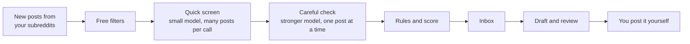
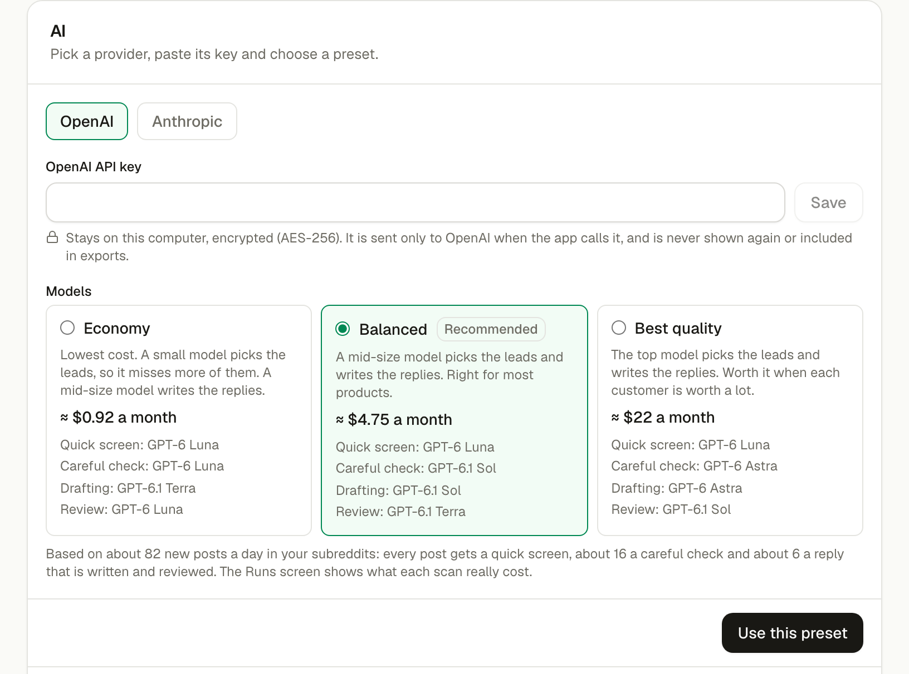

<p align="center">
  
</p>

<h1 align="center">Octosift</h1>

<p align="center">
  <strong>Find the people on Reddit who need what you built, and reply to them yourself.</strong>
</p>

<p align="center">
  Open source and self-hosted. Octosift reads the subreddits you choose, explains which posts
  are real leads, and drafts honest replies in your voice. You post every one of them by hand.
</p>

<p align="center">
  <a href="#quick-start">Quick start</a> ·
  <a href="#how-it-works">How it works</a> ·
  <a href="#what-it-costs">Cost</a> ·
  <a href="#responsible-use">Responsible use</a> ·
  <a href="docs/architecture.md">Docs</a> ·
  <a href="CONTRIBUTING.md">Contributing</a>
</p>

<p align="center">
  <a href="LICENSE"></a>
  
  
  
</p>

<picture>
  <source media="(prefers-color-scheme: dark)" srcset="docs/images/inbox-dark.png" />
  
</picture>

## Why

The people who need your product rarely search for it. They ask a community: _"What do you
all use for this?"_ Those posts are the best leads you will ever get, and they are buried in
thousands of others. Keyword alerts flood you with noise, and replies that read like ads get
removed, downvoted or banned.

Octosift does the reading for you. It watches a short list of communities, picks out the
posts where you can genuinely help, tells you why, and prepares a reply that is useful even
without the sentence about your product. Then you decide what to post.

## Features

- **Leads you can check.** Every post gets a verdict, a score and a reason. Open any scan to
  see each post it read and why it was kept or dropped.
- **Replies in your voice, reviewed before you see them.** A second model checks each draft
  the way a moderator would: it answers the question, invents nothing, says you built the
  product and does not read like an ad. Pick the angle and length, or ask for a rewrite in
  plain words. When an author invites messages, a private message draft is ready too.
- **Guardrails against looking like a spammer.** Drafts say plainly that you built the
  product. Subreddits that ban promotion get replies that do not mention it. Pacing warnings
  tell you when to help without a mention for a while. With a connected account, the app later
  checks that your reply is still visible.
- **Learns from you.** Mark a lead as good or bad with a short note, and the next scans
  follow it as a rule.
- **Your own AI key, low cost.** OpenAI, Anthropic, or any OpenAI-compatible endpoint such as
  Ollama, LM Studio or OpenRouter. Presets show an estimated monthly cost, and budget caps
  stop a scan cleanly.
- **Private by design.** Runs on your machine with a local SQLite file. Keys and the Reddit
  session are encrypted. No telemetry and no analytics.
- **Fits your workflow.** Keyboard shortcuts in the inbox, a webhook for Slack or Discord, a
  command line, Docker, and a mentions tab for posts that name your product.

<table>
  <tr>
    <td width="50%"></td>
    <td width="50%"></td>
  </tr>
  <tr>
    <td align="center"><sub>Home: what is waiting and what the scanner is doing</sub></td>
    <td align="center"><sub>Every scan shows each post and the reason for its verdict</sub></td>
  </tr>
</table>

## How it works



1. **It learns your product.** Give it your website. It reads a few pages, drafts a profile
   (what the product does, who it is for, what it does _not_ do) and asks a few questions to
   sharpen it.
2. **It suggests subreddits.** You confirm three to ten communities where your customers ask
   for help.
3. **It reads new posts on a schedule.** Every hour by default, slowly and one request at a
   time.
4. **It judges every post.** Free filters drop removed posts, bots, spam, old posts and other
   languages. A small model screens the rest. A stronger model checks the survivors one at a
   time, then fixed rules can only lower the result. Posts that score 60 or more reach the
   inbox.
5. **It prepares replies for the strongest leads.** Posts that score 75 or more, or any lead
   you ask for, get a draft and a review. You copy it, open the thread and post it yourself.

### What it does not do

- **It does not post, comment, vote or send messages.** A connected Reddit account is only
  used to read. Every reply is posted by you.
- **It does not watch all of Reddit.** It reads only the short list of subreddits you chose.
- **It does not hide who is speaking.** Whenever a draft mentions your product, it says you
  built it.

## Quick start

**Try the demo first.** It needs no key and no network: a sample product, synthetic Reddit
posts and a simulated AI provider.

```sh
pnpm install
pnpm demo
```

Open http://127.0.0.1:3005.

**Then set it up for real:**

```sh
cp .env.example .env   # optional: every setting can also be made in the dashboard
pnpm build
pnpm start             # the dashboard and the background worker
```

Open http://127.0.0.1:3005 and follow the onboarding: add an OpenAI or Anthropic key and pick
a preset, connect a Reddit account, describe your product, confirm the suggested subreddits
and run a first scan. It takes about five minutes. You can leave at any step; Home and the
sidebar show what is left. The Reddit account is optional, the other steps are needed for
leads.

<details>
<summary><strong>Requirements</strong></summary>

- [pnpm](https://pnpm.io) and Node.js on a long-term support line: 22.12 or later, 24
  (recommended, and what `.nvmrc` selects) or 26. Node 20 and odd-numbered releases are not
  supported.
- On Node 26 the SQLite driver is compiled during `pnpm install`, which needs a C++ toolchain
  (Xcode command line tools on macOS; `python3`, `make` and `g++` on Linux).

</details>

<details>
<summary><strong>With Docker</strong></summary>

```sh
docker compose up --build
```

The dashboard is published on 127.0.0.1:3005 only, and data lives in a named volume. Put keys
and options in `.env` (see `.env.example`). Set `APP_PASSWORD` before you expose the
dashboard beyond your own machine. In Docker, connect Reddit by pasting the session cookie;
the sign-in window needs a desktop.

</details>

<details>
<summary><strong>From the command line</strong></summary>

```sh
pnpm scan --once              # one scan now, prints the new leads
pnpm scan --once --dry-run    # fetch and judge, save nothing but the run
pnpm scan --once --json       # the full report as JSON
pnpm cli check-source         # one test request with the configured Reddit source
pnpm eval --yes-spend         # measure precision and recall on labelled sample posts
```

</details>

For development, `pnpm dev` runs the dashboard and the worker with reloading.

## What it costs

Octosift is free. You pay your AI provider for what it uses, and reading Reddit costs
nothing. Choose a preset, **Economy**, **Balanced** (recommended) or **Best quality**, and the
app shows an estimate for your own subreddits before you spend anything.

<p align="center">
  
</p>

Costs stay low because each stage only sees what the stage before it let through. An
illustrative scan of five subreddits that finds 40 new posts, with a small model at
$0.15/$0.60 and a strong model at $3/$15 per million input/output tokens:

| Stage                  | Calls | Input tokens | Output tokens |            Cost |
| ---------------------- | ----: | -----------: | ------------: | --------------: |
| Free filters           |     0 |            0 |             0 |          $0.000 |
| Quick screen (small)   |     4 |       14,000 |         1,600 |          $0.003 |
| Careful check (strong) |     8 |       14,400 |         2,000 |          $0.073 |
| Draft (strong)         |     3 |        5,100 |           900 |          $0.029 |
| Review (small)         |     3 |        4,800 |           360 |          $0.001 |
| **Total**              |       |              |               | **about $0.11** |

Your numbers will differ. Every scan's real cost is shown on the Runs screen, from a price
table you can edit. Budget caps (by default $0.50 per scan and $3 per 24 hours) stop a scan
cleanly and leave the remaining posts for the next one.

<details>
<summary><strong>A worked example, and how to spend less</strong></summary>

Cost follows the number of new posts, because each post is judged once. Take ten subreddits
that together get about 40 new posts an hour, scanned hourly with the models above: about
$0.11 a scan, $2.60 a day, $80 a month. The default caps hold it near there.

- **Keep a small model for the quick screen.** It reads every post that passes the free
  filters. With the strong model in its place, the example would cost about $125 a month.
- **Watch fewer or quieter subreddits.** Five subreddits with 20 new posts an hour together
  cost about $40 a month.
- **Choose a cheaper model for the careful check and drafting.** The strong model is most of
  the bill. Run `pnpm eval --yes-spend` before and after switching to see what it does to
  precision.
- **Scanning less often barely helps.** A post costs the same in whichever scan reads it.

Under Settings → AI → Advanced you can pick a model per stage, or point a stage at a local
model through any OpenAI-compatible endpoint.

</details>

## How it reads Reddit

In late 2026 Reddit announced the end of its public RSS feeds and closed its public data API
to new apps. Octosift reads Reddit in one of two ways and falls back between them:

1. **A Reddit account you connect** (recommended). You sign in on Reddit's own page in a
   browser window the app opens, so the app never sees your password; in Docker you paste the
   session cookie instead. The session is stored encrypted and only ever sent to
   www.reddit.com.
2. **Public RSS feeds** (logged out, best effort). Reddit is retiring them, so they may stop
   working at any time.

Either way, reading is deliberately slow and narrow:

- only what it needs: new posts in the subreddits you chose, and the threads and checks
  described here;
- one request at a time, at least eight seconds apart;
- **at most 120 requests an hour, a fixed limit you cannot raise in settings;**
- a pause instead of retries when Reddit pushes back.

A connected account also runs two checks at the same pace. An hour and a day after you mark a
lead as replied, the app checks that your comment is still visible to others. Once a day it
checks the account's public profile and warns if Reddit shows it as suspended or missing.
[More about sources and checks](docs/sources.md).

## Responsible use

Octosift is built to help you show up where you are useful, not to flood communities.

**Toward communities**

- **Follow each subreddit's rules.** Paste a subreddit's rules on the Subreddits screen and
  they become guidance for its drafts. Mark subreddits that do not allow promotion; their
  drafts never mention your product.
- **Say who you are.** Every draft that mentions your product says that you built it. Keep it
  that way when you edit.
- **Help first.** A good reply is useful even with the product sentence removed. The pacing
  warnings ask for about three helpful replies for each one that mentions the product.
- **Never invent experience.** Drafts are told not to claim results, customers or comparisons
  that are not in your profile. Check before you post.

**Toward Reddit**

- **Use a separate account to read.** Reddit can limit accounts that read automatically. Read
  with a spare account and reply from your own.
- **Keep the limits.** The pacing above is part of the design. Please do not fork it into a
  bulk scraper.
- **You are responsible for your use.** Using a Reddit account with this app is subject to
  [Reddit's User Agreement](https://redditinc.com/policies/user-agreement) and each
  community's rules. The software comes with no warranty (see the [license](LICENSE)).

## Privacy and security

Everything stays on the machine that runs Octosift: a SQLite file, plus an encryption key
that never leaves it. API keys and the Reddit session are encrypted with AES-256-GCM. The
dashboard listens on 127.0.0.1 by default, and `APP_PASSWORD` protects it when you expose it.
The app talks only to Reddit (to read), the AI provider you configure, and the optional
integrations you turn on. Reddit posts are treated as untrusted input in every prompt.

Details: [docs/privacy.md](docs/privacy.md). To report a vulnerability, see
[SECURITY.md](SECURITY.md).

## Configuration

Most settings live in the dashboard and are stored in the local database. Environment
variables (see `.env.example`) cover deployment and can supply keys.

| Variable                                                           | Default                      | Purpose                                                              |
| ------------------------------------------------------------------ | ---------------------------- | -------------------------------------------------------------------- |
| `DATABASE_PATH`                                                    | `data/app.sqlite`            | Where the database lives                                             |
| `APP_SECRET`                                                       | random key in `data/.secret` | Encrypts saved API keys and the Reddit session                       |
| `APP_PASSWORD`                                                     | none                         | Requires a password to open the dashboard                            |
| `HOST`, `PORT`                                                     | `127.0.0.1`, `3005`          | Where the dashboard listens                                          |
| `PUBLIC_URL`                                                       | `http://127.0.0.1:3005`      | Used for links in notifications                                      |
| `LOG_LEVEL`                                                        | `info`                       | `debug`, `info`, `warn` or `error`                                   |
| `DEMO_MODE`                                                        | off                          | Synthetic data and a simulated AI provider                           |
| `OPENAI_API_KEY`, `ANTHROPIC_API_KEY`, `OPENAI_COMPATIBLE_API_KEY` | none                         | Provider keys; they take precedence over keys saved in the dashboard |
| `REDDIT_SESSION_COOKIE`                                            | none                         | The Cookie header of a connected Reddit account, instead of Settings |
| `REDDIT_PROXY_URL`                                                 | none                         | Proxy for Reddit reads                                               |
| `WEBHOOK_URL`                                                      | none                         | Webhook for strong leads (Slack-style or Discord-style)              |
| `DATAFORSEO_LOGIN`, `DATAFORSEO_PASSWORD`                          | none                         | Optional: finds Reddit threads that rank on Google for your keywords |

The dashboard also holds the model for each stage, prices, budget caps, the scan interval,
score thresholds, filters, your Reddit username (so your own posts are skipped) and whether
images in posts are described for the models (off by default).

**Evergreen threads (optional).** With DataForSEO credentials, an Evergreen tab lists Reddit
threads that rank on Google for your buyer keywords, checked weekly or on demand. A helpful
reply in a thread that ranks keeps paying off for months. A check costs about $0.004 per
keyword, and the exact cost of each one is shown.

## FAQ

**Does it work for my kind of product?** Nothing in the code assumes an industry or an
audience; everything specific comes from your product profile. The test suite runs the whole
pipeline against three unrelated sample products: an invoicing tool for freelancers, a
consumer plant-care app and a developer command-line tool.

**How do I know it finds the right posts?** Every verdict has a reason you can read on the
Runs screen, and your good and bad marks become rules. `pnpm eval --yes-spend` measures the
precision and recall of your chosen models on a labelled set of sample posts. It explains what
it will send before it starts and stops at a cap (one dollar by default).

**Can I use a local model?** Yes. Choose "OpenAI-compatible" and point it at Ollama or LM
Studio. Small local models are fine for the quick screen; the careful check and drafting
benefit from stronger ones.

**Why is the first scan slow?** Reads are spaced out on purpose: several seconds apart with an
account, about a minute apart logged out. The AI stages are quick.

**Will it post for me one day?** No. Posting by hand is the point: it keeps you in control of
what goes out under your name.

## Roadmap

- A browser extension for one-click copy on Reddit itself.
- More sources besides Reddit.
- An MCP server, so assistants can query your leads.

## Documentation

- [Architecture](docs/architecture.md)
- [The pipeline and its prompts](docs/pipeline.md)
- [Data sources and the checks made with a connected account](docs/sources.md)
- [How logged-out Reddit reads behave](docs/reddit-reads.md)
- [Privacy: what is stored and where](docs/privacy.md)
- [Adding a new source](docs/adding-a-source.md)
- [Decisions](docs/decisions.md)

## Contributing

Bug reports, ideas and pull requests are welcome. [CONTRIBUTING.md](CONTRIBUTING.md) explains
how to set up, test and send a change.

```sh
pnpm check       # lint, typecheck, unit tests and the leak check
pnpm test:e2e    # Playwright smoke tests in demo mode
```

## License

Octosift is licensed under the [GNU Affero General Public License v3.0](LICENSE). You may
use, change and self-host it freely. If you run a modified version as a service for other
people, you must offer them its source code under the same license.
